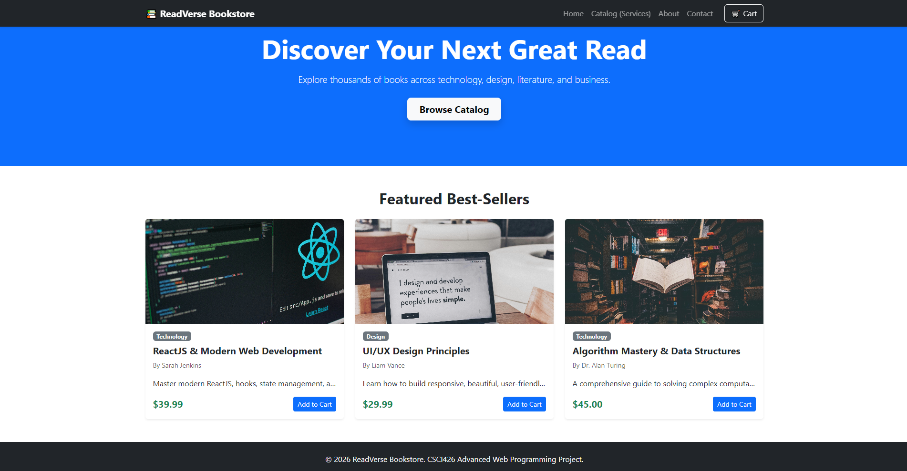
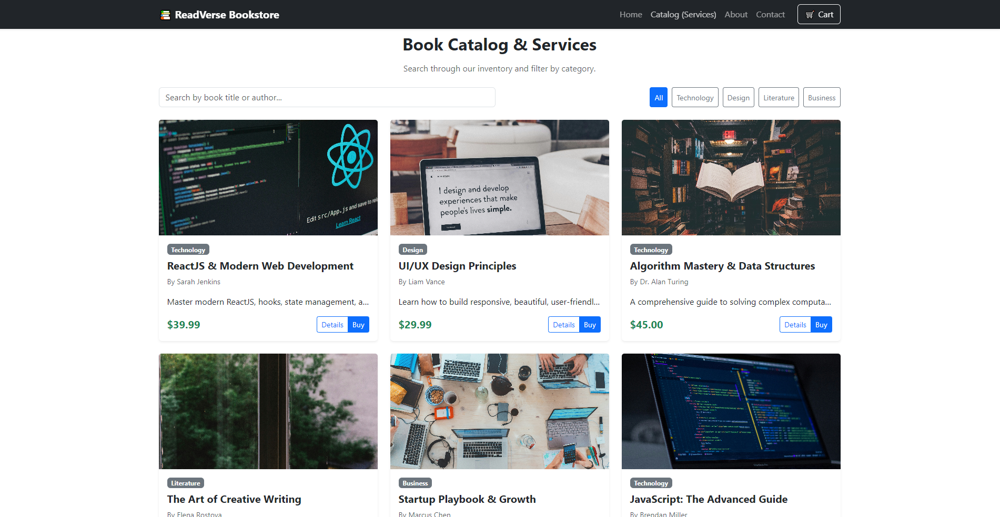
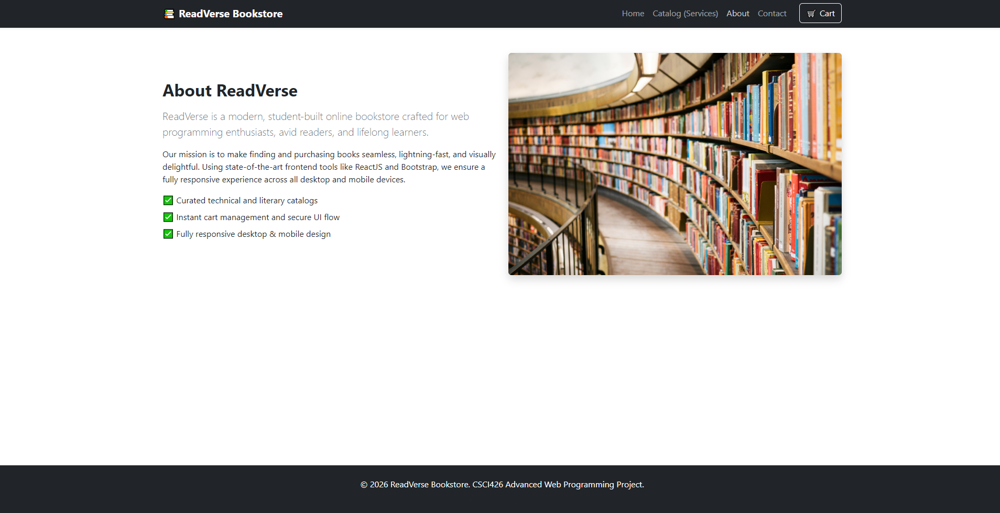
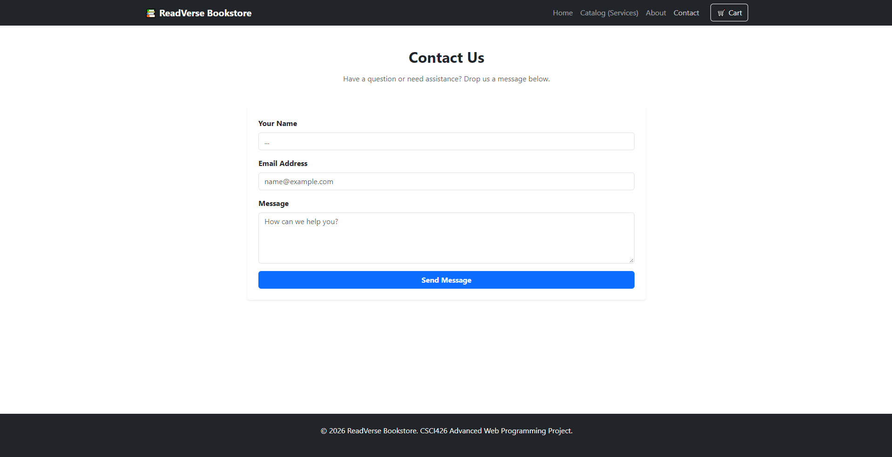
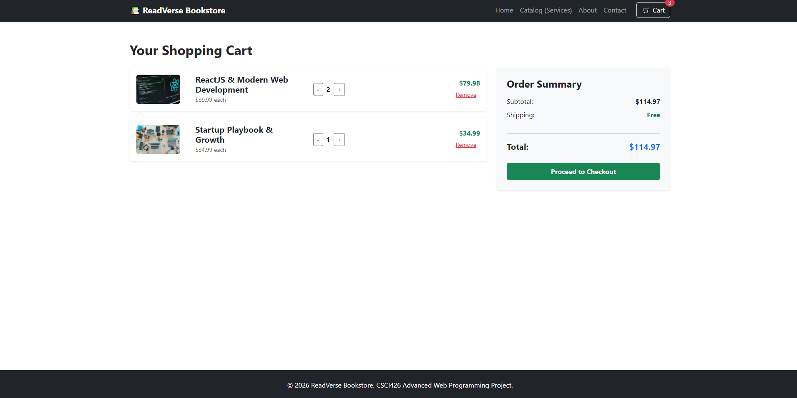

# 📚 ReadVerse Online Bookstore - CSCI426 Project Phase 1

A responsive, frontend functional web application built with **ReactJS** and **Bootstrap**[cite: 1, 2] as part of the CSCI426 Advanced Web Programming coursework.

## 🚀 Project Description
ReadVerse is an online bookstore designed to automate the process of browsing technical and literary catalogs, searching inventory by title/author, filtering by category, inspecting individual book details, and managing a fully dynamic shopping cart[cite: 1].

## 🛠️ Technologies Used
* **Frontend Library:** ReactJS (Vite)[cite: 1]
* **Styling:** Bootstrap 5 & React Bootstrap[cite: 1, 2]
* **Routing:** React Router DOM v6
* **Version Control:** Git & GitHub

## 📱 Pages Included
1. **Home:** Featured best-sellers banner and quick access[cite: 1].

2. **Catalog (Services):** Search bar and interactive category filter[cite: 1].

3. **About:** Project overview and mission statement[cite: 1].

4. **Contact:** Interactive contact form with submission state[cite: 1].

5. **Book Details & Cart (Dynamic Page):** Dynamic routing for individual book inspection and real-time cart quantity/checkout management[cite: 1].

